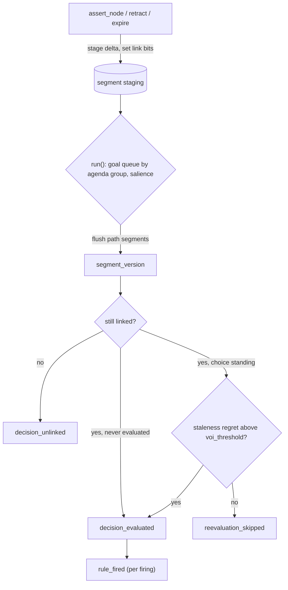

# stare-decisis

*Stare decisis*: to stand by things decided.

An audit log for decisions that combine policy rules, probabilistic models, and LLM output.

Every decision it records can answer seven questions:

1. What evidence did it rest on, and which form of reasoning produced each piece?
2. Which policy rules and utility functions applied, in which versions, authored by whom?
3. What would it have seen if you replayed it today, exactly as it was made?
4. Would it have gone differently with every error since discovered removed?
5. When the evidence changed, why was it (or wasn't it) reconsidered?
6. What would reversing it break now, how did that grow, and is it locked in?
7. Has anyone altered the record?

It is pure Python (3.10+), has no runtime dependencies, and stores its log in SQLite.

---

## Contents

- [Why](#why)
- [Install](#install)
- [Quick start](#quick-start)
- [Concepts](#concepts)
  - [Three memory layers](#three-memory-layers)
  - [Lifecycle](#lifecycle)
  - [Reasoning forms](#reasoning-forms)
  - [Re-evaluation and value of information](#re-evaluation-and-value-of-information)
  - [Retraction](#retraction)
  - [Expiry](#expiry)
  - [LLM output freezing](#llm-output-freezing)
  - [Policy rules](#policy-rules)
  - [Human overrides](#human-overrides)
  - [Decision dependencies and reversal exposure](#decision-dependencies-and-reversal-exposure)
  - [Decision amortization](#decision-amortization)
  - [The log](#the-log)
- [Auditing](#auditing)
- [Command line](#command-line)
- [API reference](#api-reference)
- [Writing a segment model](#writing-a-segment-model)
- [Worked example](#worked-example)
- [Project layout](#project-layout)
- [Testing](#testing)
- [Design notes](#design-notes)
- [Limitations](#limitations)
- [Roadmap](#roadmap)
- [Releasing](#releasing)
- [References](#references)
- [License](#license)

---

## Why

Hybrid decision systems mix three kinds of reasoning that fail in different ways.  Rule engines fail through brittle authority: a wrong or outdated rule fires with full confidence.  Probabilistic models fail through misspecification and drift.  LLMs fail through plausible output: an explanation that reads well and is false.

Each kind can be audited on its own terms, but the decision is made by the combination, and that combination is what regulators, model-risk teams, and courts ask about.  stare-decisis keeps the roles separate and records how they combined:

| Stage | Role | Typical source |
|---|---|---|
| propose | generate options and hypotheses | LLM (abduction, analogy) |
| score | form beliefs from evidence | Bayesian and EM models (induction) |
| select | choose by expected utility | explicit, versioned utility function |
| enforce | apply hard constraints and policy | versioned rules (deduction, authority) |

---

## Install

From a clone:

```bash
pip install -e .            # library and the stare-decisis command
pip install -e ".[dev]"     # adds pytest
```

No third-party packages are required at runtime.

---

## Quick start

```python
from stare_decisis import (
    AuditLog, BetaBernoulli, Decision, Engine, NodeType, Option,
    ReasoningForm, Rule, UtilityFunction,
)

eng = Engine(AuditLog("ledger.db"))

# Segment: a belief shared by any decision that needs it
eng.add_segment("repayment", BetaBernoulli(2, 2))

# Rule: a versioned, authored policy constraint
eng.add_rule(Rule(
    "min_repayment", 1, author="Credit Policy",
    condition=lambda c: c["option_id"] == "increase"
    and c["beliefs"]["repayment"]["mean"] < 0.75,
))

# Decision: path of segments, options, utility, constraints
eng.add_decision(Decision(
    "cli-1",
    path=("repayment",),
    options=(Option("hold"), Option("increase")),
    utility=UtilityFunction(
        "cli_value", 1, author="Risk",
        fn=lambda option, beliefs: 0.0 if option == "hold"
        else 1000 * (beliefs["repayment"]["mean"] - 0.8),
    ),
    constraints=("min_repayment",),
    voi_threshold=5.0,
))

# Evidence: typed, sourced, tagged with its reasoning form and real-world time
eng.assert_node(
    "pay-1", NodeType.OBSERVATION, 1, ReasoningForm.INDUCTION,
    {"id": "bureau"}, valid_time="2026-09-15", segments=["repayment"],
)

outcomes = eng.run()                          # lazy: work happens here
audit = eng.auditor()
audit.verify()                                # hash chain intact?
audit.reasoning_trail("cli-1", "cli-1#1")     # what the choice rests on
audit.replay_as_corrected("cli-1", "cli-1#1") # would it change today?
```

---

## Concepts

### Three memory layers

The memory model is borrowed from PHREAK, the lazy successor to Rete used in Drools 6 and later.

| Layer | Class | Holds |
|---|---|---|
| Node | `Node` | One piece of evidence: an observation, an LLM hypothesis, a latent estimate, or a rule fact.  It is typed, sourced, tagged with a reasoning form, and stamped with both `valid_time` and `tx_time`. |
| Segment | `Segment` | A belief shared by every decision whose path includes it, kept as sufficient statistics.  Every change produces an immutable, numbered `SegmentVersion` that lists the nodes it consumed. |
| Decision | `Decision` | A path of segments, options, a versioned utility function, versioned constraint rules, a salience, an agenda group, a re-evaluation threshold, and the standing choice. |

What carries over from PHREAK:

- **Staging.**  Asserting or retracting a node only queues a delta on the segments it feeds, so no belief is computed at assertion time.
- **Linking.**  A segment is linked once it holds at least one live node, counting staged ones.  A decision is linked only when every segment on its path is.  An unlinked decision is never evaluated, so nothing is ever decided on missing inputs.
- **Lazy goal queue.**  `run()` processes linked, dirty decisions one agenda group at a time, highest salience first.  Decisions outside the active group cost nothing.
- **Set-oriented flush.**  A segment applies all of its staged changes in one pass and produces exactly one new version.  When several decisions share a segment, it is flushed once, and each decision records which version it consumed.

### Lifecycle



Each box at the end of the flow is a log record.

### Reasoning forms

Every node is tagged with the form of reasoning that produced it:

| Form | Structure | Typical node |
|---|---|---|
| `deduction` | rule + case → result | output of a rule engine |
| `induction` | cases + results → rule | observations feeding a fitted model |
| `abduction` | rule + result → case | an LLM's explanation of an observation |
| `analogy` | source case + similarity → target result | precedent retrieval |
| `authority` | source + claim → belief | a policy table, a regulator's figure |

`reasoning_trail()` counts the forms behind a selected option and flags the risky combinations.  For example, `selected_option_rests_on_unverified_llm_abduction` fires when every origin of the chosen option is an LLM abduction.

### Re-evaluation and value of information

In PHREAK a node is either dirty or clean.  Here, dirtiness is graded.  When a segment on a decision's path changes, the engine does a dry run under the new beliefs and computes the **staleness regret** of the standing choice:

```
regret = EU_new(choice the system would now make) − EU_new(standing choice)
```

The regret is zero when the new evidence cannot change the choice.

| Condition | Result |
|---|---|
| regret ≤ `voi_threshold` | `reevaluation_skipped`, recording the regret, the threshold, `could_flip`, and `would_select` |
| regret > threshold | `decision_evaluated` with trigger `voi_exceeded` |
| standing choice now blocked, withdrawn, or overtaken by a mandate | re-evaluated regardless of regret |
| utility function changed, or an option's origin retracted | re-evaluated regardless of regret |

Skips are logged deliberately.  "Why didn't you reconsider when X changed?" is a standard audit question, and without a skip record the only honest answer is a gap in the log.

### Retraction

`retract(node_id, reason_code, reason_text, discovered_by, discovery_ref)` is a soft delete: the node and its value stay in the log forever.

- **Dependency edges.**  Every segment version lists the nodes it consumed, so the retraction record can include each `segment@version` that used the node (`affected_segments`), found by reverse lookup.
- **Correction.**  Conjugate segments (`BetaBernoulli`, `NormalKnownVariance`) correct by subtracting the node's sufficient statistics.  Segments that can't subtract (`GaussianMixtureEM`) are refit from the surviving evidence.  The method used is recorded as `recompute_method`.
- **Withdrawn options.**  An option whose every origin node is retracted is withdrawn, and the decision is re-evaluated.
- **Coded reasons.**  `source_error`, `extraction_error`, `model_hallucination`, `superseded`, `adversarial`.  Because the reasons are coded, retractions can be analyzed in aggregate: `retraction_clusters()` groups hallucinations by prompt hash or model.

### Expiry

A segment may declare a `freshness` window (a `timedelta`).  Calling `expire(as_of)` stages the removal of every node whose age exceeds that window.  Age is measured from `valid_time`, or from `tx_time` when no `valid_time` was given.  Each removal is logged as `node_expired`, and the segment's next version carries the trigger `scheduled`.

Expiry is deliberately separate from retraction.  Expired evidence was sound when it was used, so `replay_as_corrected()` does not exclude it.  The node also stays live for any segment whose window it still fits.

### LLM output freezing

Sampled generation isn't reproducible.  An `llm_hypothesis` node must therefore carry `LLMProvenance(model, prompt_hash, temperature, seed)`, and the first output recorded for that key is the output of record.  Asserting again with the same key returns the frozen node rather than storing a new generation.  The log also records an `output_hash` of the stored output, which lets you confirm later that the output of record hasn't changed.

### Policy rules

A `Rule` is immutable and authored, and it is referred to as `rule_id@version`.  To change a rule, register a new version; the old one stays resolvable for replay.

| Action | Tested | Effect |
|---|---|---|
| `block` (default) | per option | removes the option if `condition(ctx)` is true |
| `mandate` | once per decision | forces `target_option` regardless of expected utility |

The condition receives a context dictionary:

```python
{
    "decision_id": "cli-1",
    "option_id": "increase",          # None for mandate rules
    "beliefs": {"repayment": {"mean": 0.79, "var": 0.01, "n": 10, ...}},
    "origin_nodes": [                  # nodes that proposed this option
        {"node_id": "...", "node_type": "...", "reasoning_form": "...",
         "value": ..., "live": True},
    ],
}
```

Every evaluation records each rule's result per option (`pass`, `fail`, or `mandate`) together with its author.  Every firing is also logged as its own `rule_fired` record.

### Human overrides

`human_override(decision_id, chosen_option, actor, reason_code, reason_text)` replaces the standing choice and logs who made the change and why.  Overrides are sticky.  If later evidence makes the system prefer a different option, the evaluation keeps the human's choice and records the disagreement in `system_recommendation`.  A policy rule that blocks the human's choice revokes the override, and that evaluation is flagged `human_override_revoked_by_policy`.

### Decision dependencies and reversal exposure

Decisions get built on other decisions.  Once an integration is designed around a vendor, a launch is scheduled around the integration, and so on, reversing the first decision costs more each month.  The ledger records those dependencies when they are created rather than estimating them afterward.

`publish_outcome(decision_id, node_id, segments=...)` turns a standing choice into a `decision_outcome` node.  The node records which choice it assumes, and downstream decisions can use it in two ways:

| Use | How | Meaning |
|---|---|---|
| assumption | list it in an `Option`'s `origin_nodes` | "this option assumes X holds" |
| evidence | route it into a segment | the outcome feeds a belief |

An option whose origin node hasn't been published yet is *pending*: it's unavailable, it's listed in `pending_options`, and publishing the node forces re-evaluation.

**Cascade.**  When a decision settles on a different choice, through re-evaluation or a human override, every published outcome that assumed the old choice is retracted as `superseded`, with `discovered_by="engine:cascade"`.  Downstream options whose assumption was retracted are withdrawn, and segments subtract the outcome.  The change then propagates through every level of dependency.  `run()` repeats its passes until nothing is pending, so a cascade settles within a single call even when it reaches decisions in an earlier agenda group.  A cycle of published outcomes that never settles raises an error after `max_passes`.

**Exposure.**  `reversal_exposure(decision_id, as_of_seq=None, weights=None)` lists every downstream decision whose standing choice currently depends on this one: how many levels down it sits, whether it depends by assumption or by evidence, and its standing choice.  Weights let you price each dependent; the default weight is 1.  The `curve` field replays exposure at every record that changed it, starting from the first publication.  This is how lock-in accrues, measured from the log rather than modeled with a guessed growth rate.

```python
eng.publish_outcome("vendor", "vendor-kept")
eng.add_decision(Decision("integrate", ("capacity",),
    (Option("wait"), Option("build", origin_nodes=("vendor-kept",))), ...))
...
eng.auditor().reversal_exposure("vendor", weights={"integrate": 120_000, "launch": 450_000})
# dependent_count 2, max_depth 2, exposure 570000.0
# dependents: integrate (depth 1, via assumption vendor-kept),
#             launch    (depth 2, via evidence integrate-built)
# curve (seq, dependents, exposure): (9, 0, 0) -> (10, 1, 120000) -> (14, 2, 570000)
# (output from the chain fixture in tests/test_dependencies.py)
```

Supersession is not error.  `replay_as_corrected(..., reasons=[...])` limits which retraction codes count.  Leave out `superseded` to ask whether a downstream decision was *wrong*; include it to ask whether it would *still stand*.

### Decision amortization

A decision is a commitment whose cost of reversal changes over its life.  The ledger tracks two quantities at every check, both in expected-utility units:

| Symbol | Meaning | Source |
|---|---|---|
| regret(t) | how far the standing choice trails the best available alternative under current beliefs | staleness regret, computed on every change |
| R(t) | reversal cost: the decision's own `direct_reversal_cost` plus the `unwind_cost` of every decision currently resting on it | measured from live published outcomes |

The decision reverses only when regret clears the hurdle `voi_threshold + R(t)`.  Every check in between is logged with one of these statuses:

| Status | Condition | Meaning |
|---|---|---|
| `sound` | regret = 0 | the standing choice is still the best |
| `within_tolerance` | 0 < regret ≤ voi_threshold | worse, but within the noise the decision tolerates |
| `impaired` | voi_threshold < regret ≤ hurdle | worse than the alternative, but reversing costs more than it gains: locked in |
| `reversed` | regret > hurdle | the choice changed, and the cascade unwinds the dependents |

Being impaired is the accounting for lock-in.  The decision is underwater, and the log records by how much (`regret`) and how much room is left before reversing becomes worthwhile (`lock_in_margin`).  Because R(t) grows as other decisions build on this one, the same bad news that would trigger a reversal in month one is absorbed as an impairment in month nine.  The schedule makes that visible.

```python
Decision("vendor", ..., direct_reversal_cost=5.0)
Decision("integrate", ..., unwind_cost=10.0)   # builds on vendor
Decision("launch", ..., unwind_cost=15.0)      # builds on integrate

eng.reversal_cost("vendor")   # {"direct": 5.0, "exposure": 25.0, "total": 30.0,
                              #  "dependents": {"integrate": 1, "launch": 2}}
eng.auditor().amortization_schedule("vendor")
# statuses over time: initial -> impaired (regret 10 < hurdle 30) -> reversed (regret 34.6 > 30)
```

Costs default to zero, so decisions that don't declare them behave exactly as before.  The units have to match the utility function's: if utilities are in dollars, so are the costs.

### The log

- **Append-only.**  SQLite triggers reject `UPDATE` and `DELETE`.
- **Hash-chained.**  Each record's hash covers its sequence number, type, both timestamps, payload, and the previous record's hash.  `verify()` reports the first record that doesn't check out.
- **Bitemporal.**  `tx_time` is when the ledger recorded a fact; `valid_time` is when it was true in the world, as supplied by the caller.
- **Canonical.**  Payloads are hashed as sorted-key, compact UTF-8 JSON.

Node types are `observation`, `llm_hypothesis`, `latent_estimate`, `rule_fact`, and `decision_outcome`.  The event types are `node_asserted`, `node_retracted`, `node_expired`, `segment_version`, `decision_linked`, `decision_unlinked`, `decision_evaluated`, `reevaluation_skipped`, `rule_fired`, and `human_override`.  Every field of every event is listed in **[docs/schema.md](docs/schema.md)**.

---

## Auditing

```python
audit = eng.auditor()          # or Auditor(AuditLog("ledger.db")) with no engine
```

| Question | Method | Needs engine |
|---|---|---|
| Is the log intact? | `verify()` | no |
| What did the decision see when it was made? | `reconstruct_as_made(decision_id, eval_id)` | no |
| Would it go differently with what we know now? | `replay_as_corrected(decision_id, eval_id, as_of_seq=None, reasons=None)` | yes |
| What would reversing it break, and how did that grow? | `reversal_exposure(decision_id, as_of_seq=None, weights=None)` | no |
| Is it locked in, and since when? | `amortization_schedule(decision_id)` | no |
| What did this node feed? | `retraction_impact(node_id)` | no |
| Do retractions cluster by prompt, model, or source? | `retraction_clusters(reason_code, key)` | no |
| Does the choice rest on deduction or on one unverified abduction? | `reasoning_trail(decision_id, eval_id)` | no |
| Why wasn't it revisited? | `skipped_reevaluations(decision_id)` | no |
| Everything that happened to a decision | `history(decision_id)` | no |

**As made** uses only records written before the evaluation, so later evidence and later retractions cannot leak in.

**As corrected** reruns the evaluation with every retraction known as of `as_of_seq` applied, the whole log by default.  It uses the utility version and rule versions that the original evaluation recorded, so the evidence is the only thing that changes.  Replay requires the engine because models, utilities, and rules are code.  The log stores their refs and hashes, and replay refuses to run on a model whose spec hash differs from the one recorded.

---

## Command line

The CLI works on a log file alone; it needs no engine.

```bash
stare-decisis verify   ledger.db                     # exit 0 intact, 2 broken
stare-decisis history  ledger.db cli-4471
stare-decisis as-made  ledger.db cli-4471 cli-4471#1
stare-decisis trail    ledger.db cli-4471 cli-4471#1
stare-decisis impact   ledger.db h-newjob
stare-decisis clusters ledger.db --reason model_hallucination --key prompt_hash
stare-decisis exposure ledger.db vendor --as-of 120
stare-decisis amortization ledger.db vendor
stare-decisis skipped  ledger.db cli-4471
```

`python -m stare_decisis ...` works too.  Example output from the worked example:

```console
$ stare-decisis skipped ledger.db cli-4471
[
  {
    "could_flip": false,
    "decision_id": "cli-4471",
    "standing_eval_id": "cli-4471#1",
    "standing_option": "increase",
    "trigger_segments": ["repayment@2"],
    "tx_time": "2026-10-01T09:00:28.000000+00:00",
    "voi_estimate": 0.0,
    "voi_method": "staleness_regret",
    "voi_threshold": 5.0,
    "would_select": "increase"
  }
]
```

---

## API reference

### `Engine(log=None, clock=None)`

Pass either a log (an `AuditLog`, carrying its own clock) or a clock, not both.

| Method | Purpose |
|---|---|
| `add_segment(segment_id, model, prior_ref=None, extract=None, freshness=None)` | Register a segment.  `extract` maps a node's value to the model's input; `freshness` is a `timedelta`. |
| `add_rule(rule)` | Register a rule version. |
| `add_decision(decision)` | Register a decision.  Its segments and rules must already exist. |
| `set_utility(decision_id, utility)` | Swap in a new utility version and force re-evaluation. |
| `assert_node(node_id, node_type, value, reasoning_form, source, *, valid_time=None, llm_provenance=None, segments=())` | Log a node and stage it into segments.  `source` must include `"id"`. |
| `retract(node_id, reason_code, reason_text, discovered_by, discovery_ref=None)` | Soft-delete a node. |
| `expire(as_of)` | Stage the removal of evidence older than each segment's freshness window. |
| `run(agenda_group=None, max_passes=100)` | Process pending decisions and return a list of `Outcome`s (`evaluated`, `skipped`, `unlinked`).  Without a group, passes repeat until cascades settle. |
| `publish_outcome(decision_id, node_id, *, value=None, segments=(), reasoning_form=AUTHORITY, valid_time=None)` | Publish the standing choice as a contingent `decision_outcome` node. |
| `dependents(decision_id)` | Decisions currently resting on this one, mapped to their depth. |
| `reversal_cost(decision_id)` | R(t): direct cost plus the unwind cost of current dependents. |
| `pending(agenda_group=None)` | Decisions that `run()` would process, in order. |
| `human_override(decision_id, chosen_option, actor, reason_code, reason_text)` | Replace the standing choice. |
| `standing(decision_id)` | The current `StandingChoice`. |
| `auditor()` | An `Auditor` bound to this engine. |

### Building blocks

| Class | Signature |
|---|---|
| `Decision` | `(decision_id, path, options, utility, constraints=(), salience=0, agenda_group=SELECT, voi_threshold=0.0, direct_reversal_cost=0.0, unwind_cost=0.0)` |
| `Option` | `(option_id, origin_nodes=(), description="")` |
| `UtilityFunction` | `(fn_id, version, author, fn, description="")` where `fn(option_id, beliefs) -> float` and `beliefs` maps segment id to posterior summary |
| `Rule` | `(rule_id, version, author, condition, action=BLOCK, target_option=None, salience=0, agenda_group=ENFORCE, description="")` |
| `LLMProvenance` | `(model, prompt_hash, temperature=0.0, seed=None)` |
| `AuditLog` | `(path=":memory:", clock=None)` |
| `ManualClock` | `(start="2026-01-01T00:00:00+00:00", step_seconds=1.0)` for deterministic tests |

### Segment models

| Model | Incremental | Subtractable | Summary keys |
|---|---|---|---|
| `BetaBernoulli(prior_alpha=1, prior_beta=1)` | yes | yes | `alpha`, `beta`, `mean`, `var`, `n` |
| `NormalKnownVariance(prior_mean, prior_var, noise_var)` | yes | yes | `mean`, `var`, `n` |
| `GaussianMixtureEM(k=2, max_iter=200, tol=1e-8, var_floor=1e-6)` | no (replay) | no (replay) | `mean`, `p_high`, `high_mean`, `components`, `loglik`, `iterations`, `converged`, `n` |

`GaussianMixtureEM` is a one-dimensional mixture fitted by EM, with deterministic quantile initialization and a log-space E-step.  It reports the weight of its highest-mean component as `p_high`, which is the usual way a latent-regime estimate feeds a decision.

### Vocabularies

`NodeType`, `ReasoningForm`, `ReasonCode`, `AgendaGroup`, `ChoiceRule`, `RuleAction`, `RecomputeMethod`, `Trigger`, and `EventType` are string enums.  Their values are what appear in the log.

---

## Writing a segment model

Subclass `SegmentModel`.  Declare what your sufficient statistics support, and the engine picks the cheapest correct update.

```python
from stare_decisis import SegmentModel

class PoissonGamma(SegmentModel):
    name = "poisson_gamma"
    incremental = True
    subtractable = True

    def __init__(self, shape=1.0, rate=1.0):
        self.shape, self.rate = shape, rate

    def params(self):
        return {"shape": self.shape, "rate": self.rate}

    def empty_state(self):
        return {"n": 0, "total": 0}

    def add(self, s, x):
        return {"n": s["n"] + 1, "total": s["total"] + x}

    def subtract(self, s, x):
        return {"n": s["n"] - 1, "total": s["total"] - x}

    def summary(self, s):
        a, b = self.shape + s["total"], self.rate + s["n"]
        return {"mean": a / b, "var": a / b**2, "n": s["n"]}
```

| Flags | Insert | Retract or expire |
|---|---|---|
| incremental and subtractable | `add` | `subtract` |
| incremental only | `add` | `fit` over surviving nodes |
| neither | `fit` | `fit` |

Models that aren't incremental must override `fit(values)`.  Each model's `spec()`, its name plus `params()`, is hashed into every segment version, so replay can detect a model that changed after the fact.

---

## Worked example

```bash
python examples/credit_line.py ledger.db
```

The example walks through a credit-line-increase decision:

1. It sets up ten repayment observations feeding a Beta segment, payroll and LLM-extracted income-growth figures feeding a Normal segment, and card spend feeding a two-regime EM segment.
2. An LLM proposes an abductive hypothesis, "applicant changed employer," which is the origin of the `increase` option.
3. The first run selects `increase`.
4. One more on-time payment produces a `reevaluation_skipped` record with regret 0.0.
5. The hypothesis is retracted as `model_hallucination`, and the income figure derived from it as `extraction_error`.
6. The next run withdraws `increase` and selects `hold`, with trigger `option_origin_retracted`.
7. The audit then shows the trail for the first evaluation (flagged as resting on unverified LLM abduction), the as-corrected replay (`changed: true`), the retraction impact, and the hallucination clusters.

The decision's history:

```text
seq 20  decision_linked
seq 26  decision_evaluated    cli-4471#1  initial
seq 29  reevaluation_skipped  cli-4471#1
seq 33  decision_evaluated    cli-4471#2  option_origin_retracted
```

---

## Project layout

```text
src/stare_decisis/
  engine.py      three memory layers, goal queue, evaluation, retraction, expiry, outcome cascade
  segments.py    staging, linking, set-oriented flush, segment versions
  models.py      BetaBernoulli, NormalKnownVariance, GaussianMixtureEM
  nodes.py       node memory, LLM provenance freezing, soft-delete state
  decisions.py   Decision, Option, UtilityFunction, standing choice
  rules.py       immutable versioned rules
  selection.py   expected utility + block/mandate rules (shared by engine and replay)
  log.py         append-only hash-chained SQLite log
  audit.py       as-made, as-corrected, impact, clusters, trail, exposure, amortization, skips
  cli.py         command-line auditor
  hashing.py     canonical JSON and hashing
  clock.py       system and manual clocks
  vocab.py       controlled vocabularies
docs/schema.md   every event and field
examples/        credit_line.py
tests/           75 tests, stdlib unittest (pytest-compatible)
```

---

## Testing

```bash
python -m unittest discover -s tests -v   # stdlib only
pytest                                     # with the dev extra
```

CI runs both test commands, the worked example with `stare-decisis verify`, and a package build checked by `twine check --strict`, on Python 3.10–3.13.  The tests cover:

- chain verification and tamper detection
- the append-only triggers
- posterior math, and subtraction matching a full refit
- EM regime recovery
- staging, linking, and netting of changes within a batch
- salience order, and a shared segment being flushed only once
- skip versus re-evaluate around the threshold
- block and mandate rules
- LLM freezing
- retraction by subtraction and by replay
- unlink and relink
- withdrawn options
- override persistence and revocation
- as-made isolation and as-corrected replay against the recorded versions
- expiry
- publishing decision outcomes, pending options, and multi-level reversal cascades (including into an earlier agenda group)
- reversal exposure and its curve
- cost-aware reversal: impaired versus reversed, and the amortization schedule
- replay filtered by retraction reason
- the CLI

---

## Design notes

**Why soft delete rather than truth-maintenance labels.**  The ledger tracks one current context plus its history; it doesn't reason over several hypothetical worlds at once.  A justification-style dependency list (which nodes each segment version consumed) is enough for that, and it is far cheaper to keep than ATMS assumption-set labels.

**Why log skips.**  An audit trail that records only actions can't distinguish "considered and declined" from "never noticed."

**Why version utilities.**  A utility function is a value judgment.  Recording its ref and author on every evaluation means a value judgment can't change without leaving a trace.

**Why separate expiry from retraction.**  A retraction says the evidence was wrong.  An expiry says it is old.  Mixing them would make as-corrected replays punish decisions for using evidence that was valid at the time.

**Why measure reversal exposure instead of modeling it.**  Lock-in grows when later decisions depend on earlier ones.  Those dependencies are facts, and the ledger records them as they are created, so exposure can be counted from the log rather than projected from an assumed growth curve.  The pricing belongs to the caller, through `weights`.  The count does not depend on a guessed price.

**Why reversal cost raises the hurdle instead of being a separate check.**  Re-evaluation already asks whether the change is worth acting on.  Adding R(t) to the hurdle makes that one question cost-aware, so there's a single place where "worse" and "worth reversing" are compared, and a single log record of the answer.

**Why the engine and replay share `select()`.**  If replay used different selection logic from the engine, a changed outcome could come from the code rather than the evidence.

---

## Limitations

- **Not a full PHREAK implementation.**  The memory layering, linking, staging, goal queue, and set-oriented flush come from PHREAK, but constraint rules are evaluated as Python predicates, not compiled into a discrimination network.  For large rule bases, put a production engine behind `Rule.condition`.
- **Staleness regret is a proxy for value of information.**  It answers "would the choice change now," which is the question re-evaluation needs.  It is not expected value of information over evidence not yet observed.
- **Engine state lives in memory.**  The log is durable and sufficient for audit, but rebuilding a live engine from the log is not implemented.
- **One process, one writer.**  This matches what a hash chain needs, but it isn't built for concurrent writers.
- **Tamper evidence, not tamper proofing.**  Someone with write access can rewrite and re-chain the whole log.  To prevent that, anchor chain heads externally (see Roadmap).
- **Payloads must be JSON-serializable**, and the log stores node values inline.

---

## Roadmap

- Rehydrate a live engine from the log
- Signed checkpoints and external anchoring of chain heads
- An adapter for running rule conditions in an external rule engine
- Expected-VOI re-evaluation for decisions with cheap preposterior analysis
- Multivariate and hierarchical segment models (partial pooling as formalized analogy)
- Postgres backend
- Retention policy for node values, keeping hashes after the payload is purged
- Exposure alerts: a scheduled check that flags decisions whose exposure crosses a threshold while reversal is still cheap
- Parametric reversal-cost curves (fitted to the measured exposure history) for projecting when a decision will lock in

---

## Releasing

Releases go to PyPI through trusted publishing; no API token is stored anywhere.

1. One time: on pypi.org, under Your projects → Publishing, add a pending publisher for this repository with workflow `release.yml` and environment `pypi`.
2. Bump `__version__` in `src/stare_decisis/__init__.py`.  It is the only place the version is set.
3. Commit, tag `v<version>`, and publish a GitHub release from the tag.

`.github/workflows/release.yml` checks that the tag matches `__version__`, builds the package, validates it with `twine check --strict`, and uploads it.  CI runs the same build and check on every push.  PyPI never accepts a version number twice.

---

## References

- Forgy, C. L. (1982).  Rete: A fast algorithm for the many pattern/many object pattern match problem.  *Artificial Intelligence*, 19(1), 17–37.
- Drools 6.5 documentation, chapter 5, "Hybrid Reasoning" (Rete, ReteOO, PHREAK).  https://docs.drools.org/6.5.0.Final/drools-docs/html/ch05.html
- Doyle, J. (1979).  A truth maintenance system.  *Artificial Intelligence*, 12(3), 231–272.
- de Kleer, J. (1986).  An assumption-based TMS.  *Artificial Intelligence*, 28(2), 127–162.
- Dempster, A. P., Laird, N. M., & Rubin, D. B. (1977).  Maximum likelihood from incomplete data via the EM algorithm.  *Journal of the Royal Statistical Society, Series B*, 39(1), 1–38.
- Dixit, A. K., & Pindyck, R. S. (1994).  *Investment under Uncertainty*.  Princeton University Press.  (Irreversibility and the option value of waiting.)
- Arthur, W. B. (1989).  Competing technologies, increasing returns, and lock-in by historical events.  *The Economic Journal*, 99(394), 116–131.
- Peirce, C. S.  Deduction, induction, and hypothesis (1878), and later writing on abduction.

---

## License

Apache License 2.0.  See [LICENSE](LICENSE) and [NOTICE](NOTICE).

Copyright 2026 Timothy Poschel.
